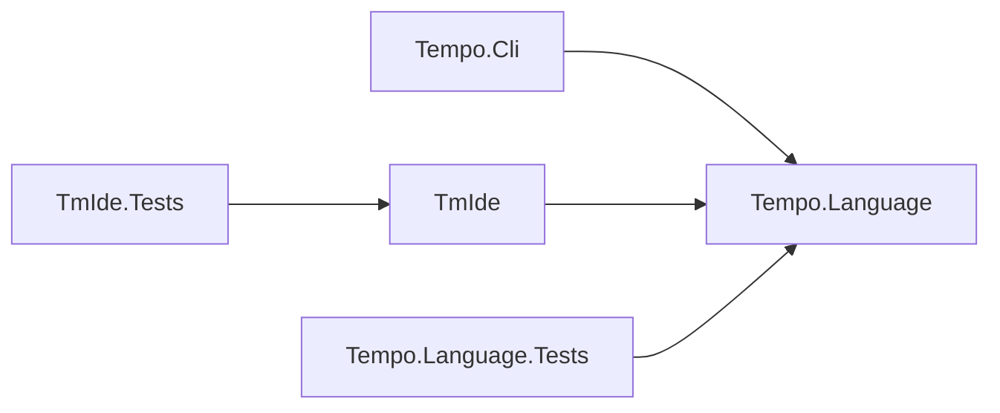
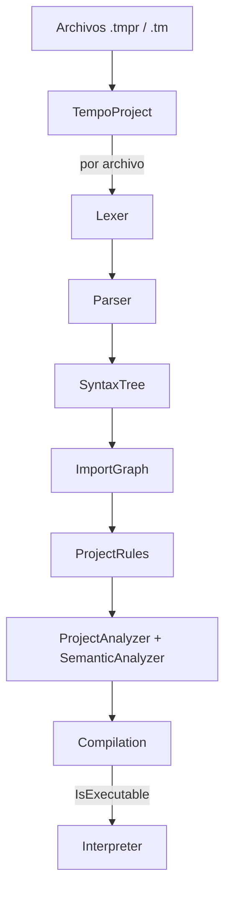
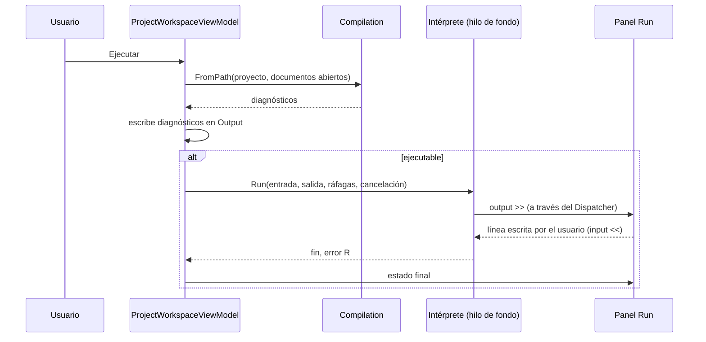

# Arquitectura

Este documento describe cómo está construida la implementación del lenguaje
Tempo (TM): la organización de la solución, el diseño del compilador y del
intérprete, la herramienta de línea de comandos y el entorno de desarrollo
TmIde. Las reglas del lenguaje se definen en
[ESPECIFICACION-TM.md](ESPECIFICACION-TM.md).

## Contenido

1. [Visión general](#1-visión-general)
2. [Tempo.Language](#2-tempolanguage)
3. [Tempo.Cli](#3-tempocli)
4. [TmIde](#4-tmide)
5. [Pruebas](#5-pruebas)
6. [Configuración de compilación](#6-configuración-de-compilación)

---

## 1. Visión general

La solución `tempo-rp.slnx` agrupa cinco proyectos .NET:

| Proyecto | Tipo | Marco | Responsabilidad |
|---|---|---|---|
| `src/Tempo.Language` | Biblioteca | `net8.0` | Compilador e intérprete de TM. No depende de ninguna interfaz de usuario. |
| `src/Tempo.Cli` | Aplicación de consola | `net8.0` | Compila y ejecuta proyectos TM desde la terminal. |
| `src/TmIde` | Aplicación WPF | `net10.0-windows` | Entorno de desarrollo gráfico para TM. |
| `tests/Tempo.Language.Tests` | Pruebas xUnit | `net8.0` | Verificación del compilador y del intérprete. |
| `tests/TmIde.Tests` | Pruebas xUnit | `net10.0-windows` | Verificación de servicios, controles y ViewModels del IDE. |



El principio que ordena la solución es que **existe un único compilador**. La
CLI y el IDE son *hosts*: entregan un proyecto a la fachada `Compilation`,
presentan sus diagnósticos y, si procede, lo ejecutan conectando la entrada, la
salida y las ráfagas a su propio medio. Así, lo que el editor subraya, lo que
informa la acción Compilar del IDE y lo que imprime la CLI salen del mismo
análisis.

---

## 2. Tempo.Language

### 2.1 Organización

| Carpeta | Contenido |
|---|---|
| `Syntax/` | Tokens, analizador léxico (`Lexer`), analizador sintáctico (`Parser`), nodos del árbol de sintaxis abstracta (AST), `SyntaxTree` y `SyntaxFacts`. |
| `Symbols/` | Modelo de tipos (`TmType`, `TypeKind`, `TypeNameParser`) y símbolos de variables y funciones. |
| `Binding/` | Análisis semántico: tabla de símbolos, resolución de tipos, reglas de operadores, de asignabilidad y de retorno. |
| `Projects/` | Proyecto multiarchivo (`TempoProject`), grafo de importaciones y reglas estructurales. |
| `Diagnostics/` | Modelo de diagnóstico, catálogo de códigos y colectores. |
| `Evaluation/` | Intérprete, valores y entornos de ejecución, contratos del host. |
| `Outline/` | Resumen de un archivo para herramientas de edición. |
| `IO/` | Reportes de texto de tokens, AST y diagnósticos. |
| `Compilation.cs` | Fachada pública del compilador. |

### 2.2 Canal de compilación



`Compilation.Create` encadena las fases en un orden fijo:

1. **Importaciones.** `ImportGraph.Resolve` resuelve cada `import` contra el
   disco, carga los archivos que todavía no forman parte del proyecto, detecta
   los ciclos y calcula el orden de dependencias.
2. **Errores de sintaxis.** Recoge el diagnóstico léxico o sintáctico de cada
   archivo que no pudo analizarse.
3. **Reglas de proyecto.** Aplica cada regla de `ProjectRules.All`.
4. **Semántica.** `ProjectAnalyzer` analiza los archivos en orden de
   dependencias y después aplica las comprobaciones que abarcan todo el
   proyecto.

### 2.3 Fachada `Compilation`

Es el único punto de entrada que necesitan los hosts:

```csharp
Compilation compilation = Compilation.FromPath(ruta, documentosAbiertos);

foreach (Diagnostic diagnostic in compilation.Diagnostics)
{
    Console.WriteLine(diagnostic.ToStandardFormat());
}

if (compilation.IsExecutable)
{
    compilation.Run(entrada, salida, rafagas, cancellationToken);
}
```

| Miembro | Descripción |
|---|---|
| `FromPath(path, openDocuments)` | Compila un directorio o un archivo. `openDocuments` (ruta → texto) sustituye el contenido en disco. |
| `Project` | El `TempoProject` compilado. |
| `Diagnostics` | Diagnósticos de todos los archivos, ordenados por archivo y línea. |
| `HasErrors` / `IsExecutable` | Estado del resultado. |
| `DiagnosticsOf(path)` | Diagnósticos de un archivo. |
| `OutlineOf(path)` | Funciones y nombres locales de un archivo, para el autocompletado. |
| `TempoBpm` | Ritmo declarado por `tempo`, o el valor por defecto. |
| `Run(input, output, pulse, token)` | Ejecuta el proyecto. |

### 2.4 Análisis léxico y sintáctico

- **`SyntaxFacts`** es la fuente única de los hechos léxicos: la tabla de
  palabras reservadas (lexema, token y papel) y las reglas de los
  identificadores. La consultan el `Lexer`, el coloreado y el autocompletado del
  IDE.
- **`Lexer`** recorre el texto carácter a carácter, descarta comentarios y
  espacio, y produce tokens con línea y columna. Ante un error lanza
  `LexerException` con el código del diagnóstico.
- **`Parser`** es un analizador descendente recursivo con un método por regla de
  la gramática y un nivel de método por nivel de precedencia. Resuelve el doble
  papel de `>` y `<` con lectura anticipada de un token y la posición de las
  líneas. Ante un error lanza `ParserException`.
- **`SyntaxTree`** encapsula ambos: contiene el AST (`ProgramNode`) o, si el
  análisis falló, el diagnóstico correspondiente. Como el error queda guardado
  en lugar de propagarse, un archivo con errores no interrumpe el análisis del
  resto del proyecto.

El AST está formado por *records* inmutables: un `ProgramNode` con sus
importaciones, declaraciones `tempo`, funciones y sesión; nodos de sentencia
(`StatementNode`) y nodos de expresión (`ExpressionNode`). Cada nodo conserva la
línea y la columna de su origen.

### 2.5 Proyectos e importaciones

- **`TempoProject`** abre un proyecto desde un directorio (todos sus `.tm` y
  `.tmpr`) o desde un archivo (el archivo y lo que importa). Los documentos
  abiertos en un editor sustituyen al disco y los que aún no se han guardado
  también se incorporan, de modo que se compila lo que el usuario ve.
- **`ImportGraph`** recorre el grafo de importaciones en profundidad. Ese mismo
  recorrido detecta los ciclos (E012), deja cada archivo después de los que
  importa y permite calcular qué archivos son visibles desde cada uno, con la
  transitividad que exige la importación textual.
- **`IProjectRule`** define una comprobación estructural. `ProjectRules.All`
  enumera las reglas vigentes: un único `.tmpr` por directorio (E016, E017),
  módulos sin `session` (E015) y `tempo` solo en el `.tmpr` (E041). Añadir una
  regla es implementar la interfaz y añadirla a la lista.

### 2.6 Análisis semántico

| Componente | Responsabilidad |
|---|---|
| `ProjectAnalyzer` | Analiza cada archivo en orden de dependencias entregándole las firmas de los archivos que ve; después informa las funciones duplicadas entre archivos (E013) y las nunca invocadas en todo el proyecto (W003). |
| `SemanticAnalyzer` | Orquesta el análisis de un archivo: recolecta firmas, analiza `tempo`, las funciones y la sesión. |
| `FunctionSignatureCollector` | Primera pasada: registra todas las firmas antes de analizar ningún cuerpo, lo que permite llamar a funciones declaradas más abajo. |
| `StatementAnalyzer` | Recorre las sentencias, gestiona los ámbitos y aplica las reglas de declaración, asignación, E/S, control y retorno. |
| `ExpressionTypeResolver` | Sintetiza el tipo de cada expresión y comprueba llamadas, indexaciones y literales de colección. |
| `OperatorRuleTable` | Tabla de operadores expresada como datos: cada firma `(operador, tipo, tipo)` se asocia a su tipo resultado. |
| `TypeCompatibility` | Reglas de asignabilidad, incluido el tratamiento de `silence`. |
| `ReturnPathAnalyzer` | Determina estructuralmente si un bloque retorna en todas sus trayectorias. |
| `ConstantExpressionEvaluator` | Decide si un inicializador de `const` es una expresión constante. |
| `SymbolTable` / `Scope` | Pila de ámbitos de variables y espacio global de funciones. |

**Tipo error.** Cuando una expresión no puede tiparse, el resolutor devuelve
`TmType.Unknown`, y todas las reglas aceptan ese tipo sin informar nada. Cada
problema se informa una vez en su origen y no genera una cascada de errores
derivados. Del mismo modo, un identificador no declarado se registra con tipo
desconocido para no repetir el error en sus usos posteriores.

**Modelo de tipos.** `TmType` es un *record*: la igualdad entre tipos
compuestos es estructural y recursiva sin comparadores propios. El parser deja
los nombres de tipo como texto en el AST y `TypeNameParser` es el único punto
que los interpreta.

### 2.7 Diagnósticos

| Tipo | Descripción |
|---|---|
| `Diagnostic` | *Record* con severidad, código, título, archivo, línea, descripción, sugerencia y, opcionalmente, columna. `ToStandardFormat()` produce el bloque de cinco campos. |
| `DiagnosticCodes` | Constantes con nombre para cada código. |
| `DiagnosticCatalog` | Título oficial de cada código. Ningún analizador redacta títulos por su cuenta. |
| `DiagnosticBag` | Colector de los diagnósticos de un archivo. |
| `ProjectDiagnostics` | Colector de todo el proyecto, que entrega los diagnósticos ordenados. |

Los errores léxicos y sintácticos llevan columna; los semánticos solo línea.

### 2.8 Intérprete

El intérprete recorre el AST de un programa ya validado.

| Componente | Responsabilidad |
|---|---|
| `Interpreter` | Crea el entorno global y ejecuta la sesión. |
| `StatementExecutor` | Ejecuta las sentencias y comprueba la cancelación antes de cada una y al entrar en cada bloque. |
| `ExpressionEvaluator` | Evalúa expresiones, con aritmética comprobada y cortocircuito lógico. |
| `FunctionInvoker` / `FunctionRegistry` | Resuelven y ejecutan llamadas; cada llamada crea un entorno nuevo con sus parámetros. |
| `RuntimeEnvironment` / `RuntimeVariable` | Ámbitos encadenados y variables con su tipo declarado. |
| `RuntimeValue` | Valor etiquetado con su clase (`RuntimeValueKind`). Las colecciones son `RuntimeSequence` y `RuntimeScore`. |
| `ReturnSignal` | Transporta el valor de `ret` hasta la llamada que lo espera. |
| `TmRuntimeException` | Error R### con su línea y archivo; `ToDiagnostic()` lo convierte al formato estándar con la sugerencia de `RuntimeErrorSuggestions`. |

Contratos que implementa cada host:

| Contrato | Uso | Implementación en la CLI | Implementación en el IDE |
|---|---|---|---|
| `IRuntimeInput` | `input <<` | `ConsoleRuntimeInput` | `IdeRuntimeInput` (panel Run) |
| `IRuntimeOutput` | `output >>` | `ConsoleRuntimeOutput` | `IdeRuntimeOutput` (panel Run) |
| `IRuntimePulse` | `pulse` | `NullRuntimePulse` | `IdeRuntimePulse` (panel de partículas) |

### 2.9 Soporte para herramientas

- **`FileOutline`** resume un archivo analizado: las funciones que puede invocar
  (propias e importadas) con su firma, y los nombres locales de cada función o
  de la sesión con su tipo y su tramo de líneas. Es la base del autocompletado de
  símbolos.
- **`IO/`** genera los reportes de texto de la CLI: tabla de tokens, árbol
  sintáctico y bloque de diagnósticos por archivo.

---

## 3. Tempo.Cli

```text
Tempo.Cli <directorio | archivo.tmpr | archivo.tm> [--tokens] [--ast]
```

| Opción | Efecto |
|---|---|
| `--tokens` | Imprime los tokens del archivo de entrada. |
| `--ast` | Imprime el árbol sintáctico del archivo de entrada. |

Funcionamiento:

1. Compila la ruta con `Compilation.FromPath`.
2. Imprime un reporte de diagnósticos del archivo de entrada y uno por cada otro
   archivo que tenga diagnósticos, más los diagnósticos del proyecto que no
   pertenecen a ningún archivo (por ejemplo, E016).
3. Si el proyecto es ejecutable, lo ejecuta sobre la consola. Un error de
   ejecución se escribe en la salida de error con el formato estándar.

| Código de salida | Significado |
|---|---|
| `0` | Compilación sin errores y, si correspondía, ejecución completa. |
| `1` | La ruta no existe o la compilación tiene errores. |
| `2` | Error de ejecución R###. |

---

## 4. TmIde

### 4.1 Arranque y composición

`App` es la raíz de composición. Construye un *Generic Host* de
`Microsoft.Extensions.Hosting` que aporta:

- **Inyección de dependencias.** Servicios y ViewModels del shell se registran
  como únicos; las ventanas, como transitorias, para que cada apertura cree una
  instancia limpia. El contenedor valida todos los registros al arrancar.
- **Registro interno.** Serilog escribe a
  `%LOCALAPPDATA%\TmIde\logs\tmide-AAAAMMDD.log`, con un archivo por día y los
  últimos siete conservados. Las excepciones no controladas quedan registradas.
- **Configuración.** La sección `Ide` de `appsettings.json` se enlaza a
  `IdeOptions` (`MaxRecentProjects`, `DefaultTheme`).

Al iniciar se muestra la ventana de inicio. La ventana principal solo se abre
cuando en ella se crea o se abre un proyecto; cerrarla sin elegir ninguno
termina la aplicación.

### 4.2 Patrón MVVM

- Los ViewModels heredan de `ViewModelBase` (sobre `ObservableObject` de
  CommunityToolkit.Mvvm) y usan los generadores `[ObservableProperty]` y
  `[RelayCommand]`.
- Las regiones se comunican mediante mensajes de `IMessenger`
  (`WeakReferenceMessenger`): apertura de archivos, cambio de documento activo,
  fin de un análisis y cambio de estado del proyecto.
- `IFlowService` centraliza la navegación entre ventanas: recibe un ViewModel y
  resuelve la ventana registrada para su tipo, de modo que ningún ViewModel crea
  vistas. Los diálogos se abstraen tras servicios (`IConfirmDialogService`,
  `INamePromptService`, `IStartDialogService`).
- El comportamiento de vista reutilizable vive en *Behaviors* de XAML
  (arrastre de ventana, maximizado al área de trabajo, foco al hacerse visible).

### 4.3 Regiones de la interfaz

```text
┌──────────────────────────────────────────────────────────────────┐
│ Barra de título y menús (MENU · EDITAR · EJECUCIÓN · VER · AYUDA) │
├──────────────┬───────────────────────────────────────────────────┤
│              │ Pestañas y ruta del documento                     │
│  Explorador  │ Editor de código                                  │
│  de archivos │                                                   │
│              ├─────────────────────────────────┬─────────────────┤
│              │ Panel inferior (Output · Run)   │ Panel de        │
│              │                                 │ partículas      │
├──────────────┴─────────────────────────────────┴─────────────────┤
│ Barra de estado                                                  │
└──────────────────────────────────────────────────────────────────┘
```

| Región | ViewModel | Función |
|---|---|---|
| Ventana de inicio | `StartViewModel` | Crear un proyecto, abrir una carpeta o reabrir un proyecto reciente. |
| Barra de título | `MenuBarViewModel` | Menús, controles de ventana y piano. |
| Explorador | `FileExplorerViewModel` | Árbol del proyecto; crear, renombrar y eliminar archivos y carpetas. |
| Editor | `EditorHostViewModel` | Pestañas de documentos y ruta del archivo activo. |
| Panel inferior | `BottomPanelViewModel` | Pestañas Output (mensajes y diagnósticos) y Run (ejecución). |
| Panel de partículas | `ParticlePanelViewModel` | Visualización del estado del proyecto y de la ejecución. |
| Barra de estado | `StatusBarViewModel` | Posición del cursor, codificación, problemas y estado del proyecto. |

`ProjectWorkspaceViewModel` es dueño del proyecto abierto y de sus operaciones:
abrir, guardar, compilar, ejecutar y detener. Expone esas operaciones como
`ProjectCommands`, que comparten el menú, la barra de estado y los atajos de
teclado.

### 4.4 Editor de código

El editor se basa en AvalonEdit y añade las capacidades propias de TM:

| Capacidad | Componentes |
|---|---|
| Coloreado de sintaxis | `TmSyntaxScanner` (escáner tolerante que nunca falla con código incompleto) y `TmSyntaxColorizer`. |
| Diagnósticos en vivo | `CodeAnalysisService`, `DiagnosticRangeResolver` y `DiagnosticsRenderer` (subrayado ondulado rojo para errores y ámbar para advertencias). |
| Autocompletado | `CompletionEngine` combina proveedores de palabras reservadas, plantillas de construcciones y símbolos del proyecto; `EditorCompletionController` decide cuándo mostrar la lista. |
| Buscar y reemplazar | Panel de búsqueda de AvalonEdit ampliado con reemplazo (`FindReplaceController`, `TextSearcher`, `DocumentReplacer`). |
| Plegado y sangría | `TmFoldingStrategy` y `TmIndentationStrategy`, que comparten las reglas de delimitadores de `TmBlockDelimiters`. |
| Ayuda contextual | `TempoKeywordReference`: equivalencia y explicación de cada palabra reservada al pasar el puntero. |

Cada pestaña conserva su propio documento, con su historial de deshacer, y el
editor recuerda cursor, desplazamiento y plegados de cada una.

**Análisis mientras se escribe.** `CodeAnalysisService` compila el directorio
del documento con `Compilation.FromPath`, pasando el texto de todos los
documentos abiertos. El resultado aporta los diagnósticos del archivo y su
`FileOutline`, y se publica a todo el IDE como `ProjectAnalyzedMessage`.

### 4.5 Compilación y ejecución



- La compilación y la ejecución corren fuera del hilo de la interfaz.
- `IdeRuntimeOutput` pasa cada escritura al hilo de la interfaz con prioridad
  baja, de modo que un bucle que escribe sin pausa no bloquea el botón Detener.
- `IdeRuntimeInput` bloquea el hilo del intérprete hasta que el usuario envía
  una línea en el panel Run; la cancelación lo libera.
- Detener cancela la ejecución antes de la siguiente sentencia.
- El panel Output agrupa los diagnósticos por categoría (importación, léxico,
  sintaxis, semántica, ejecución, advertencias) y un doble clic sobre uno abre
  el archivo en su línea y columna.

### 4.6 Panel de partículas

El panel dibuja una nube esférica de partículas que refleja el proyecto:

- **Estado del proyecto.** `DiagnosticMood` resume los diagnósticos en tres
  estados (correcto, con advertencias, con errores) y una turbulencia de 0 a 1
  que crece con el número de problemas. `MoodMixer` funde gradualmente la forma
  y el color de un estado al siguiente.
- **Ritmo.** `BeatClock` marca pulsos al ritmo de `tempo` y subdivide cada
  pulso en corcheas.
- **Ráfagas.** `IdeRuntimePulse` es un buzón concurrente y acotado: el
  intérprete deposita cada `pulse` sin esperar a la interfaz y el panel las
  recoge en el siguiente fotograma. `ParticleSimulation` lanza las chispas
  sincronizadas con la siguiente corchea.
- **Dibujo.** `FibonacciSphere` reparte los puntos sobre la esfera;
  `DotRenderer` los proyecta en perspectiva y los sombrea sobre un `DotCanvas`
  de píxeles, que se vuelca en un mapa de bits. El panel solo anima mientras
  está visible.

### 4.7 Piano

`TypingPianoService` ofrece dos modalidades, activables desde la barra de
título:

- **Escritura.** Cada carácter escrito en el editor suena como una nota
  (`PianoNoteMap`).
- **Interpretación.** El teclado se convierte en un instrumento con octava
  configurable de 2 a 6 (`PianoPerformanceKeyMap`).

`PianoSynth` es un sintetizador polifónico construido sobre NAudio. Las notas
también deforman la superficie del panel de partículas (`MusicalWave`).

### 4.8 Temas y preferencias

- **Temas.** `ThemeService` cambia en caliente el diccionario de recursos
  `Resources/Theme.Dark.xaml` o `Resources/Theme.Light.xaml`. Todas las vistas
  consumen los pinceles con `DynamicResource`, por lo que el cambio se aplica
  sin reiniciar.
- **Preferencias.** `JsonUserSettingsStore` guarda en
  `%LOCALAPPDATA%\TmIde\settings.json` el tema elegido, los proyectos recientes
  y la configuración del piano. Un archivo dañado no impide usar el IDE: se
  registra el fallo y se continúa con los valores por defecto.
- **Recursos.** Las fuentes IBM Plex Mono y JetBrains Mono y los iconos SVG
  están en `src/Assets/`.

### 4.9 Servicios

| Servicio | Responsabilidad |
|---|---|
| `ICodeAnalysisService` | Analiza un documento con el compilador. |
| `IProjectScaffolder` | Crea un proyecto nuevo con su `principal.tmpr`. |
| `IProjectFileService` | Crea, renombra y elimina archivos y carpetas; admite solo `.tm` y `.tmpr`, y un único `.tmpr` en la raíz. |
| `IRecentProjectsService` | Historial de proyectos abiertos, sin duplicados y con un máximo configurable. |
| `IUserSettingsStore` | Persistencia de preferencias. |
| `IThemeService` | Aplicación y persistencia del tema. |
| `ILanguageReferenceService` | Ventana de referencia del lenguaje con ejemplos insertables en el editor. |
| `IOutputLog` | Mensajes para el usuario en el panel Output. |
| `IFlowService` | Navegación entre ventanas. |

---

## 5. Pruebas

| Proyecto | Áreas cubiertas |
|---|---|
| `Tempo.Language.Tests` | Analizador léxico y sintáctico, códigos de diagnóstico, tipos y tabla de operadores, ámbitos, constantes, funciones y retornos, proyectos e importaciones, intérprete, errores de ejecución, cancelación y casos de verificación de la especificación. |
| `TmIde.Tests` | Autocompletado, búsqueda y reemplazo, preferencias, archivos de proyecto, temas, piano, panel de partículas, clasificación de diagnósticos y ViewModels. |

Las pruebas usan xUnit y, en el IDE, NSubstitute para sustituir dependencias.
Las que tocan el sistema de archivos trabajan sobre directorios temporales
(`ProjectWorkspace`, `TempDirectory`) y las que dependen del tiempo usan un
`TimeProvider` fijo (`FixedTimeProvider`).

---

## 6. Configuración de compilación

| Archivo | Función |
|---|---|
| `global.json` | Fija el SDK de .NET 10 (10.0.400, con avance a la última versión de características). |
| `Directory.Build.props` | Propiedades comunes: última versión de C#, nulabilidad, *usings* implícitos, analizadores recomendados y advertencias tratadas como errores. |
| `Directory.Packages.props` | Gestión centralizada de versiones NuGet. |
| `.editorconfig` | Estilo de código y convenciones de nombres, verificados durante la compilación. |

Paquetes utilizados:

| Paquete | Proyecto | Uso |
|---|---|---|
| CommunityToolkit.Mvvm | TmIde | ViewModels, comandos y mensajería. |
| AvalonEdit | TmIde | Componente de edición de texto. |
| Microsoft.Xaml.Behaviors.Wpf | TmIde | Comportamientos de vista en XAML. |
| Microsoft.Extensions.Hosting | TmIde | Host genérico, inyección de dependencias y configuración. |
| Serilog.Extensions.Hosting, Serilog.Sinks.File | TmIde | Registro interno a archivo. |
| NAudio | TmIde | Síntesis de audio del piano. |
| xunit, xunit.runner.visualstudio, Microsoft.NET.Test.Sdk, coverlet.collector | Pruebas | Ejecución de pruebas y cobertura. |
| NSubstitute | TmIde.Tests | Dobles de prueba. |

Las convenciones de código se detallan en [CONVENTIONS.md](CONVENTIONS.md).
